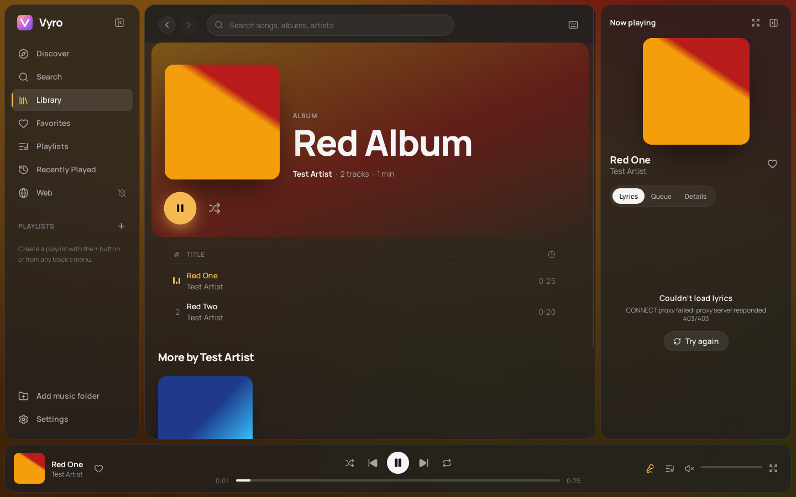

# Vyro

Vyro is an independent desktop music player for your local library. It has
album-reactive animated backgrounds, synced lyrics, a JSON theme engine and
**Vyro Shield**, an optional ad and tracker blocker for the web windows you
open from inside the app.

It is a standalone app built with Tauri 2, React and TypeScript. It is not a
client, mod or skin for any streaming service.



More screenshots of the real app on Linux are in [docs/screenshots](docs/screenshots): synced lyrics, Discover, and the Vyro Shield test page with the ad image blocked and the ad slot hidden.

## Feature status

| Feature | Status |
| --- | --- |
| Import folders and files (and drag and drop) | Done. MP3, FLAC, WAV, M4A/AAC, Ogg, Opus. Tags and embedded or `cover.jpg` artwork via `lofty`. Untagged files take title, track number, album and artist from the file and folder names. |
| Library | Done. Albums, artists, tracks and folders views; search, sort, grid and list. SQLite database with incremental rescans that skip unchanged files. |
| Playback | Done. Play and pause, previous and next, seek, shuffle, repeat (off, all, one), volume and mute, queue editing with drag reorder, resume where you left off. System media keys and Windows media overlay via the Media Session API. |
| Favorites, Recently Played, playlists | Done. All persistent. |
| Synced lyrics | Done. `.lrc` or `.txt` next to the track, then embedded tags, then [LRCLIB](https://lrclib.net) (optional). Highlighted current line, click a line to seek, fullscreen mode. |
| Dynamic backgrounds | Done. Colours extracted from the artwork, smooth crossfades between songs, animated colour fields, blurred art, light waves, particles and parallax. Presets Aurora, Sunset, Ocean, Midnight and Ambient; static colour, custom gradient or your own image. Reduced-motion and performance modes. |
| Themes | Done. Dark, light and more built in. Accent, corner radius, density, sidebar and panel layout; JSON import and export ([format](docs/THEMES.md)). |
| Vyro Shield | Done on **Windows** and **Linux**; element hiding only on macOS. See [docs/SHIELD.md](docs/SHIELD.md) for exactly what it does and doesn't do. |
| Streaming-service integrations | Not included. Vyro plays local files. |
| Gapless playback and crossfade | Not implemented. |
| macOS | Should build, but has not been tested. |

## Requirements

- **Node.js** 20 or newer (22 recommended) and npm.
- **Rust** stable, 1.80 or newer (<https://rustup.rs>).
- Platform tools:
  - **Windows 10 or 11:** *Visual Studio Build Tools* with the "Desktop
    development with C++" workload, and Rust's default MSVC toolchain. The
    WebView2 runtime ships with Windows 11. The Vyro installer downloads it on
    older systems that lack it.
  - **Linux (Debian or Ubuntu):**

    ```sh
    sudo apt install libwebkit2gtk-4.1-dev libxdo-dev libssl-dev \
      libayatana-appindicator3-dev librsvg2-dev build-essential file \
      gstreamer1.0-plugins-good gstreamer1.0-plugins-bad gstreamer1.0-libav
    ```

    The GStreamer plugins are what decode audio on Linux, so playback needs
    them at runtime as well.
  - **macOS:** Xcode Command Line Tools.

No API keys, accounts or credentials are needed. LRCLIB is a free public API
with no key, and Shield's filter lists are public downloads. Code signing is
optional; see *Windows build* below.

## Develop

```sh
npm install
npm run tauri dev      # desktop app with hot reload
npm run dev            # browser-only preview at http://localhost:1420
```

The browser preview has no desktop runtime, so it runs on a built-in demo
library with synthesized audio. A "Browser preview · demo library" badge says
so. Use it for quick UI work. Anything touching files, the database or Shield
needs `npm run tauri dev`.

## Test

```sh
npm run typecheck
npm run lint
npm test                                            # TypeScript unit tests (Vitest)
cargo test --manifest-path src-tauri/Cargo.toml     # Rust: database, scanner, palette, lyrics, Shield
```

There is also a browser smoke test of the UI. It covers playback, synced
lyrics, background transitions, queue, favorites, playlists, search, theme
switching and settings persistence across reloads. Run it against the dev
server:

```sh
npm run dev &                                  # keep it running
(cd e2e && npm install playwright-core)        # once
node e2e/preview-smoke.mjs http://localhost:1420/
# uses Chromium from CHROMIUM_PATH, default /opt/pw-browsers/chromium
```

## Build

```sh
npm run tauri build
```

Installers land in `src-tauri/target/release/bundle/`.

### Windows build

Build the Windows installer **on Windows** (or in Windows CI). Cross-compiling
NSIS or MSI installers from Linux isn't supported by Tauri in a way worth
relying on.

On a Windows 10 or 11 machine with the requirements above:

```powershell
git clone <your repo> vyro
cd vyro
npm ci
npm run tauri build -- --bundles nsis,msi
```

Output:

- `src-tauri\target\release\bundle\nsis\Vyro_0.1.0_x64-setup.exe`, a
  per-user installer that needs no admin rights;
- `src-tauri\target\release\bundle\msi\Vyro_0.1.0_x64_en-US.msi`.

Or let GitHub build it: [`.github/workflows/build.yml`](.github/workflows/build.yml)
runs the tests on Linux and builds both installers on `windows-latest` for
every push, pull request and `v*` tag. Download them from the run's
**vyro-windows** artifact. Builds from `main` are also published as a GitHub
release named after the version in `package.json` (for example `v0.1.0`). Bump
the version to start a new release; otherwise the same release's installers
are replaced.

**Signing.** Unsigned installers work, but Windows SmartScreen shows an
"unrecognized app" warning on first run. To sign, set `bundle.windows.certificateThumbprint`
(a code-signing certificate in the Windows certificate store) or
`bundle.windows.signCommand` in `src-tauri/tauri.conf.json`. See
<https://v2.tauri.app/distribute/sign/windows/>. Nothing else in Vyro needs
native configuration.

### Linux build

```sh
npm run tauri build -- --bundles deb          # .deb in src-tauri/target/release/bundle/deb/
npm run tauri build -- --bundles appimage     # needs network access to fetch linuxdeploy
```

## Keyboard shortcuts

| Action | Keys |
| --- | --- |
| Play / pause | Space |
| Next / previous track | Ctrl + → / Ctrl + ← |
| Seek ±5 s | → / ← |
| Volume up / down | Ctrl + ↑ / Ctrl + ↓ |
| Mute | M |
| Shuffle / repeat mode | S / R |
| Favorite current track | Shift + F |
| Lyrics panel / queue | L / Q |
| Fullscreen lyrics | F |
| Search | Ctrl + K |
| Settings | Ctrl + , |
| Back / forward | Alt + ← / Alt + → |
| Show all shortcuts | ? |

## Where Vyro keeps data

Everything is local, in the app data folder:

- Windows: `%APPDATA%\app.vyro.player\`
- Linux: `~/.local/share/app.vyro.player/`
- macOS: `~/Library/Application Support/app.vyro.player/`

| Path | What |
| --- | --- |
| `vyro.db` | SQLite: library, favorites, history, playlists, settings, themes, lyrics cache |
| `artwork/` | Resized cover art and extracted palettes |
| `backgrounds/` | Images you import as a custom background |
| `shield/` | Downloaded filter lists |
| `web-profile/` | Browser profile for Vyro web windows (cookies, site data) |

Deleting the folder resets Vyro. Your music files are only ever read, never
modified or moved.

## Notes and limitations

- **Audio decoding uses the system's engine.** That is WebView2 (Chromium) on
  Windows and GStreamer on Linux. ALAC inside M4A doesn't play on Windows;
  Chromium has no ALAC decoder.
- **Linux playback loads the current track into memory.** WebKitGTK refuses
  custom URL schemes for media, so on Linux each track is read whole and
  played from memory (typically 5 to 50 MB for a FLAC). Windows streams from
  disk with range requests.
- **Online lyrics** are looked up on LRCLIB by title, artist, album and
  duration. You can switch this off in Settings → Lyrics. Results and misses
  are cached, and misses are retried after a week.
- **Vyro Shield** only filters Vyro web windows, never local playback, and
  can't remove every ad. See [docs/SHIELD.md](docs/SHIELD.md).

## Project layout

```
src/                  React + TypeScript UI
  audio/              playback engine (HTMLAudioElement)
  components/         layout, background, lyrics, queue, shared controls
  lib/                pure logic: LRC parsing, colours, themes, queue, library, settings
  pages/              Discover, Search, Library, Favorites, Playlists, Recent, Web, Settings
  store/              zustand stores (player, library, settings, ui, shield)
src-tauri/src/
  db.rs               SQLite schema and queries
  scanner.rs          folder scan, tags, artwork cache
  palette.rs          artwork colour extraction
  lyrics.rs           sidecar, tag and LRCLIB lyrics
  shield/             Vyro Shield: engine, lists, Windows (WebView2) and Linux (WebKitGTK) hooks
  lib.rs              Tauri commands, events, windows
docs/                 theme format, Shield details, example theme
e2e/                  browser smoke test
```

## Licence

Vyro's own code has no licence chosen yet. Add one before publishing.
Third-party filter lists keep their own licences, listed in
[docs/SHIELD.md](docs/SHIELD.md).
